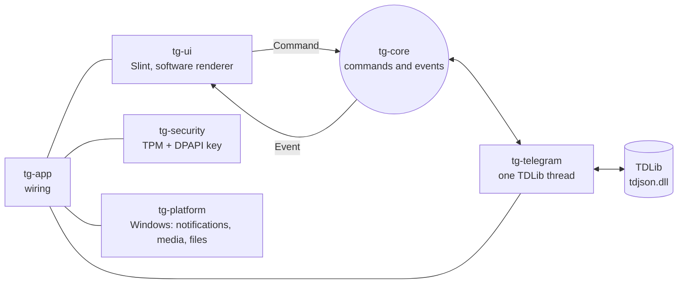

<div align="center">


# Veygram

<sub>Formerly Ferrogram.</sub>

**A native Telegram client for Windows that stays light.**<br>
Written in Rust. About 8× less memory than Telegram Desktop, measured.

[](https://github.com/tikD1337/veygram/actions/workflows/ci.yml)


[Features](#-features) · [Numbers](#-numbers) · [Try it](#-try-it) · [How it works](#%EF%B8%8F-how-it-works) · [Roadmap](docs/ROADMAP.md)

</div>

> [!IMPORTANT]
> **Veygram is an unofficial client in early development.** It is not affiliated with or endorsed
> by Telegram. It uses the official [TDLib](https://github.com/tdlib/td) library and built-in API
> credentials. Expect missing features and rough edges.

## 📸 Screenshots

> [!NOTE]
> These screenshots show an **unfinished work-in-progress build** running in demo mode with
> synthetic data (no real account). The interface is not final and will change.

<table>
  <tr>
    <td width="50%"></td>
    <td width="50%"></td>
  </tr>
  <tr>
    <td align="center"><sub>Night theme: albums, formatting, read checks, unread separator</sub></td>
    <td align="center"><sub>OLED theme: true black for OLED screens</sub></td>
  </tr>
</table>

## ✨ Why

| | |
|---|---|
| 🪶 **Light** | Every cache has a size limit in bytes. History is paged in and out while you scroll; the whole chat is never held in memory. |
| ⚡ **Quiet** | No polling and no timers while idle: the client sleeps until Telegram sends something. |
| 🔒 **Careful** | The local Telegram database is encrypted with a random key protected by the TPM and Windows DPAPI. No custom cryptography. |
| 🦀 **Native** | Rust, a software-rendered [Slint](https://slint.dev) UI and the official TDLib. No browser engine, no Electron, no Qt. |

## 📊 Numbers

Ten minutes idle on the same account, all three clients running at the same time on one machine.
Method and raw data: [docs/BENCHMARKS.md](docs/BENCHMARKS.md).

<p align="center">
  <br><br>
  
</p>

| Client | Private Bytes | CPU, % of one core | Threads |
|---|---:|---:|---:|
| **Veygram** | **57.5 MB** | **0.25** | **11** |
| Telegram Desktop | 465.0 MB | 0.37 | 80 |
| AyuGram | 541.6 MB | 0.55 | 88 |

<sub>One machine, one account, one run. Your numbers will differ; the method is documented so you can repeat it.</sub>

### Playing a video

The same channel post in all three clients: a 17 s clip, 1080×1080 at 60 fps, played to the end
in each client's media viewer, windows maximized.

<p align="center">
  <br><br>
  
</p>

| Client | Private Bytes, chat open | Private Bytes, playing | CPU while playing, % of one core | GPU memory after the viewer closed |
|---|---:|---:|---:|---:|
| **Veygram** | **105.5 MB** | **188.5 MB** | **6.5** | **0 MB** |
| Telegram Desktop | 844.8 MB | 973.8 MB | 53.9 | 191.8 MB |
| AyuGram | 1476.3 MB | 1667.4 MB | 30.7 | 143.1 MB |

<sub>Not a fully like-for-like comparison. Telegram Desktop and AyuGram autoplay videos in the
chat feed by default, which Veygram does not, and that autoplay is part of their numbers; the
clients do not show the same chat list; the clip came from each client's cache, not from the
network; one short run per client. Details: [docs/BENCHMARKS.md](docs/BENCHMARKS.md).</sub>

## 🧩 Features

**Works today**

- [x] Sign-in with a QR code or a phone number
- [x] Chat list with avatars, last message time, unread and mention badges, muted chats
- [x] Seamless history: pages load and unload while you scroll, without jumps
- [x] Opens a chat at the first unread message; marks messages read when you actually see them
- [x] Text with formatting, clickable links in messages, spoilers, right-to-left scripts and colour emoji
- [x] Photos with captions, albums as one bubble with a photo grid
- [x] Date separators, sender names in groups, read checks
- [x] Sending text messages
- [x] Sending a photo or document with a caption, from the file picker or a pasted image ¹
- [x] Reply, edit, delete and forward from a context menu
- [x] Emoji reactions: counters under the bubble, click to toggle, six quick reactions above the menu ¹
- [x] Video playback with GPU decoding (Windows Media Foundation)
- [x] Voice messages with a waveform, and round video messages played inside their circle
- [x] Files: download with progress, open with a SmartScreen mark, confirmation for programs ¹
- [x] Static stickers and single emoji drawn large
- [x] Service messages ("Anna joined the group") as centred pills
- [x] Desktop notifications that open the chat
- [x] Videos start playing while they download, with seeking into parts not yet downloaded
- [x] Interface scale from 50 to 300 %, as in Telegram Desktop
- [x] Night and OLED themes

<sub>¹ New: tested in demo mode, not yet on a live account.</sub>

**Not yet** — see the [roadmap](docs/ROADMAP.md)

The goal is parity with Telegram Desktop. [Stage 4](docs/ROADMAP.md#stage-4-features) groups the
remaining work into these areas; some already have working foundations listed above:

- [ ] **[Media & creation](docs/ROADMAP.md#41-media--creation):** send videos, albums and multiple
  files, drag-and-drop, upload progress; record voice and round video messages; edit media and
  scheduled sends.
- [ ] **[Chat interactivity](docs/ROADMAP.md#42-chat-interactivity):** polls and quizzes, the full
  reaction picker with custom and paid reactions, pinning, synchronized drafts, message links and selecting multiple messages.
- [ ] **[Channels, groups & moderation](docs/ROADMAP.md#43-channels-groups--moderation):** forums and
  topics, channel comments and discussion threads, profiles, member management and admin tools.
- [ ] **[Bots & Mini Apps](docs/ROADMAP.md#44-bots--mini-apps):** keyboards, inline queries, payments
  and Mini Apps, with an isolated WebView2 runtime started on demand and released after use.
- [ ] **[Media viewer & player](docs/ROADMAP.md#45-media-viewer--player):** fullscreen navigation,
  seeking, speed and picture-in-picture controls, GIFs, background audio, playlists and media keys.
- [ ] **[Stickers, custom emoji & rich text](docs/ROADMAP.md#46-stickers-custom-emoji--rich-text):**
  animated TGS/WebM stickers, inline custom emoji, an emoji/sticker/GIF panel and richer editing.
- [ ] **[Navigation & organization](docs/ROADMAP.md#47-navigation--organization):** chat folders,
  archive, global and in-chat search, contacts and a working main menu.
- [ ] **[Multi-account](docs/ROADMAP.md#48-multi-account):** add and switch accounts with isolated
  sessions, notifications and a shared memory budget.
- [ ] **[Calls](docs/ROADMAP.md#49-calls):** audio/video calls, group calls, screen sharing, device
  controls and resource cleanup after a call ends.
- [ ] **[Settings & customization](docs/ROADMAP.md#410-settings--customization):** profile, privacy,
  security, notifications, storage/cache management, proxies, themes and language.
- [ ] **[Windows platform & performance](docs/ROADMAP.md#411-windows-platform--performance):** tray
  support with deep memory unloading of the UI, decoded media and inactive web views, plus Windows
  integration, accessibility and verified updates.

Every area keeps caches bounded in bytes and heavy subsystems on demand, with before/after RAM
and CPU measurements against equivalent Telegram Desktop workloads.

## 🚀 Try it

### Download

For Windows 10 or 11, x64, get an official Veygram build from
[GitHub Releases](https://github.com/tikD1337/veygram/releases):

- **Installer:** run `Veygram-Setup-<version>-x64.exe`. It installs Veygram for your Windows
  account, adds a Start menu shortcut and includes TDLib and the required runtime libraries.
  For now the installer is built outside this repository; a reproducible installer build is
  tracked in [roadmap section 4.11](docs/ROADMAP.md#411-windows-platform--performance).
- **Portable archive:** [`scripts/package-release.ps1`](scripts/package-release.ps1) builds
  `Veygram-<version>-windows-x64.zip` with a `.sha256` file; not every release includes it. Unpack
  it into a folder only you can write to and start `veygram.exe`. Keep the bundled DLL files next
  to it; no installation is needed.

The builds are not code-signed yet, so Windows SmartScreen may warn when you run the installer
or start the portable app. Check the release notes and any published SHA-256 checksums.

### Demo mode, no account needed

`--demo` runs the whole interface on synthetic data, with no account, network or key files:

```powershell
cargo run --release -p tg-app -- --demo
```

### Build it yourself with your account

1. Install rustup, MSVC Build Tools and CMake, and build TDLib: [docs/SETUP.md](docs/SETUP.md).
2. Get an `api_id` and `api_hash` at <https://my.telegram.org>.
3. Copy `.env.example` to `.env` and fill in both values. Never commit that file.
4. Run:

```powershell
cargo run --release -p tg-app
```

The program is built as `target/release/veygram.exe`.

## ⚙️ How it works



- The UI and the engine talk only through plain types from `tg-core`; only `tg-telegram` touches
  TDLib, and only `tg-ui` touches the GUI toolkit.
- One engine thread blocks on TDLib and wakes only when an update arrives.
- Message text is shaped with [parley](https://github.com/linebender/parley) and rasterized with
  [swash](https://github.com/dfrg/swash) only for the rows on screen.
- Photos are decoded off the UI thread to the size actually shown, into one image cache limited
  to 24 MB.

Details and the reasoning behind each choice: [docs/ARCHITECTURE.md](docs/ARCHITECTURE.md).

## 🔒 Security

- The TDLib database key is 32 random bytes, wrapped by a non-exportable TPM key and then by
  Windows DPAPI. It is designed so that a copied data folder cannot be opened on another
  computer; that scenario has not been tested yet.
- Other programs running as your Windows user cannot read the client's memory while it runs, and
  the key itself never reaches the page file.
- If Windows ever refuses the key, the client explains it and offers to start fresh, keeping the
  old data in a backup folder instead of deleting it.
- Secrets never reach logs. Developer API credentials stay in `.env`, outside git; release
  builds carry Veygram's own application credentials, which identify the app, not you.
- Found a vulnerability? Please report it privately, see [docs/SECURITY.md](docs/SECURITY.md).

<details>
<summary><b>📁 Repository layout</b></summary>

| Path | Purpose |
|---|---|
| `crates/app` | Entry point, demo backend |
| `crates/core` | Domain model: commands and events shared by the UI and the engine |
| `crates/telegram` | TDLib-based engine; the only crate that talks to TDLib |
| `crates/ui` | Slint user interface; the only crate that uses Slint |
| `crates/security` | Database key protection (TPM, DPAPI) |
| `crates/platform` | Windows integration: notifications, video and audio playback (Media Foundation), opening files, startup error box |
| `spikes/` | Throwaway prototypes used for measurements, not part of the product |
| `scripts/` | Resource measurement, smoke tests, TDLib build and release packaging scripts |
| `bench/results/` | Raw measurement data |
| `docs/` | Architecture, benchmarks, security, roadmap, setup |

</details>

<details>
<summary><b>🛠️ Development checks</b></summary>

Before pushing, run the quick smoke test. It builds the debug client and checks, in about half a
minute, that the real client works end to end:
- the demo starts and loads chats and messages;
- a video and a voice message really play (they reach 1.5 s);
- other programs cannot read the client's memory;
- a refused key shows the recovery screen.

```powershell
.\scripts\smoke.ps1          # quick: demo, video, voice, recovery
.\scripts\smoke.ps1 -Full    # everything CI runs, about a minute
```

Every push to `main` and every pull request runs separate checks in
[GitHub Actions](https://github.com/tikD1337/veygram/actions):
1. Lint (`cargo fmt`, `clippy -D warnings`).
2. Unit tests.
3. The release build.
4. One smoke check per scenario: demo, video, voice, round, stickers, scroll (memory stays
   bounded), oled and recovery.

Each smoke check uploads its report and snapshot. Tests that need a real TPM or an installed TDLib
are skipped there.

```powershell
cargo fmt --all -- --check
cargo clippy --workspace --all-targets -- -D warnings
cargo test --workspace
```

</details>

## 📄 License

[GPL-3.0-or-later](LICENSE). Telegram is a trademark of its respective owner; this project is
an independent, unofficial client.
